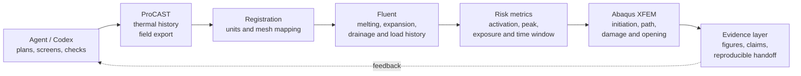

# ProCAST-Fluent-Abaqus Batch MCP

[](https://github.com/Yan-Kai-Chen/ProCAST-Abaqus-Batch-MCP/actions/workflows/ci.yml)
[](LICENSE)
[](pyproject.toml)
[](docs/mcp-boundary.md)

Codex skills, deterministic batch utilities, and a read-only MCP server for
traceable ProCAST, Fluent, and Abaqus engineering workflows.

The repository keeps its established URL and package identity while making the
actual fracture chain explicit: Fluent is the physical-time melting, drainage,
and wax-to-Shell load bridge between ProCAST thermal evidence and Abaqus XFEM.

## Project design



The Agent does not replace the commercial solvers and does not invent a crack.
It allocates fidelity, preserves provenance, automates repeatable batch work,
and promotes accepted physical-time histories to the next solver.

## Capability layers

| Layer | Purpose |
|---|---|
| Codex Skills | Physics rules, solver workflow, transfer contracts and claim boundaries |
| Core Python CLI | Environment checks, pipeline plans, solver-status parsing, pressure-risk metrics and artifact indexing |
| Optional MCP | Seven read-only tools exposing the deterministic core to Codex and other MCP clients |
| Vendor adapters | Explicit local scripts for licensed ProCAST, Visual-Environment, Fluent and Abaqus installations |

## Included skills

### ProCAST

- `procast-control-workflows`
- `procast-results-export`
- `procast-field-transfer`

### Fluent

- `fluent-dewaxing-batch-workflows`
- `fluent-wax-shell-load-extraction`
- `fluent-fracture-risk-metrics`

### Abaqus and coupled evidence

- `abaqus-wax-shell-fracture`
- `abaqus-xfem-visualization`
- `procast-fluent-abaqus-coupling`
- `simulation-evidence-reporting`

See [the capability map](docs/capability-map.md) for the consolidation from 19
project-local workflows into these 10 portable skills.

## MCP tools

| Tool | Read-only result |
|---|---|
| `check_environment` | Vendor/tool path readiness |
| `plan_pipeline` | Resolved ProCAST pipeline plan |
| `get_run_status` | ProCAST run status |
| `get_fluent_run_status` | Fluent monitor time and result inventory |
| `get_job_status` | Abaqus job status |
| `compute_pressure_risk_metrics` | Peak, exposure, threshold duration and optional activation pressure |
| `index_artifacts` | Processed-artifact inventory excluding raw solver payloads |

Solver launch, stop, restart, GUI automation and file mutation remain explicit
skill-directed actions.

## Quick start

```powershell
git clone https://github.com/Yan-Kai-Chen/ProCAST-Abaqus-Batch-MCP.git
cd ProCAST-Abaqus-Batch-MCP
python -m venv .venv
.\.venv\Scripts\python -m pip install -e ".[dev,mcp]"
.\.venv\Scripts\pytest
```

Inspect a Fluent run:

```powershell
.\.venv\Scripts\procast-fluent-abaqus fluent-status --run-root <run-directory>
```

Compute pressure-risk metrics:

```powershell
.\.venv\Scripts\procast-fluent-abaqus pressure-risk `
  --csv examples/fluent_pressure_history.example.csv `
  --pressure-column pressure_mpa `
  --threshold-mpa 1.0 `
  --temperature-column surface_temperature_c `
  --activation-temperature-c 5.0
```

Start the optional stdio MCP server:

```powershell
.\.venv\Scripts\procast-fluent-abaqus-mcp
```

## Data boundary

This project does **not** distribute ProCAST, Visual-Environment, Fluent,
Abaqus, vendor APIs, licenses, meshes, solver databases, experimental images,
or private research cases. Users supply licensed installations and local
configuration.

Copyright 2026 Yan-Kai Chen. Released under the [MIT License](LICENSE).
