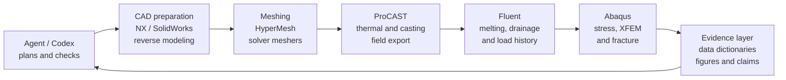

# CAE Simulation Skills MCP

[](https://github.com/Yan-Kai-Chen/CAE-Simulation-Skills-MCP/actions/workflows/ci.yml)
[](LICENSE)
[](pyproject.toml)
[](skills)
[](docs/mcp-boundary.md)

Portable Codex skills, deterministic batch utilities, and a read-only MCP
server for CAD and CAE workflows across Siemens NX, SolidWorks, HyperMesh,
ProCAST, Fluent, and Abaqus.

The project organizes software-specific knowledge as reusable skills while
keeping licensed execution, private geometry, meshes, and solver databases on
the user's workstation.

## Project design



Each stage has an explicit handoff contract. A field may not silently change
units, coordinates, physical meaning, time base, or evidence level between
software packages.

## Capability layers

| Layer | Purpose |
|---|---|
| Codex Skills | CAD, meshing, solver, coupling, physics, and reporting procedures |
| Core Python CLI | Read-only environment checks, status parsing, metrics, artifact indexing, and evidence validation |
| Optional MCP | Eight deterministic read-only tools for Codex and other MCP clients |
| Local adapters | Explicit version-aware scripts for licensed software and private project data |

## Included skills

### CAD and model preparation

- `nx-safe-edit`
- `nx-solid-modeling`
- `nx-surface-repair`
- `solidworks-safe-edit`
- `reverse-cad-modeling`

### Meshing

- `hypermesh-surface-meshing`

### ProCAST

- [procast-model-preparation](skills/procast-model-preparation/SKILL.md)
- [procast-control-workflows](skills/procast-control-workflows/SKILL.md)
- [procast-results-export](skills/procast-results-export/SKILL.md)
- [procast-field-transfer](skills/procast-field-transfer/SKILL.md)

Use the [ProCAST workflow guide](docs/procast-workflows.md) to start with an
import or design edit, a solver run, or saved results.

### Fluent

- `fluent-dewaxing-batch-workflows`
- `fluent-wax-shell-load-extraction`
- `fluent-fracture-risk-metrics`

### Abaqus and evidence

- `abaqus-wax-shell-fracture`
- [abaqus-brittle-fracture-generalization](skills/abaqus-brittle-fracture-generalization/SKILL.md)
- `abaqus-xfem-visualization`
- `simulation-evidence-reporting`

### Coupled workflow

- `procast-fluent-abaqus-coupling`

See [the capability map](docs/capability-map.md) for source consolidation and
handoff roles.

For adapting the established fracture workflow to ceramic cores, refractories,
glass, rock, concrete, or brittle interfaces, see the
[ceramic-core fracture extension guide](docs/ceramic-core-fracture-extension-zh.md).

## MCP tools

| Tool | Read-only result |
|---|---|
| `check_environment` | Configured NX, SolidWorks, HyperMesh, ProCAST, Fluent, Abaqus, and helper readiness |
| `plan_pipeline` | Resolved ProCAST pipeline plan |
| `get_run_status` | ProCAST run status |
| `get_fluent_run_status` | Fluent monitor time and result inventory |
| `get_job_status` | Abaqus job status |
| `compute_pressure_risk_metrics` | Peak, exposure, threshold duration, and optional activation pressure |
| `index_artifacts` | Processed-artifact inventory excluding raw solver payloads |
| `validate_evidence_dictionary` | Schema, unique-ID, completeness, and claim-status checks for manuscript metrics |

Solver launch, stop, restart, GUI automation, CAD mutation, and file deletion
remain explicit skill-directed local actions.

## Quick start

```powershell
git clone https://github.com/Yan-Kai-Chen/CAE-Simulation-Skills-MCP.git
cd CAE-Simulation-Skills-MCP
python -m venv .venv
.\.venv\Scripts\python -m pip install -e ".[dev,mcp]"
.\.venv\Scripts\pytest
```

Check a portable environment configuration:

```powershell
.\.venv\Scripts\cae-simulation env-check --config examples/environment.example.json
```

Inspect a Fluent run:

```powershell
.\.venv\Scripts\cae-simulation fluent-status --run-root <run-directory>
```

Validate a manuscript data dictionary:

```powershell
.\.venv\Scripts\cae-simulation validate-evidence-dictionary `
  --csv examples/evidence_dictionary.example.csv
```

Start the optional stdio MCP server:

```powershell
.\.venv\Scripts\cae-simulation-mcp
```

The historical `procast-abaqus` and `procast-fluent-abaqus` console aliases
remain available for compatibility in version 0.3.

## Data boundary

This repository does **not** distribute vendor software, licenses, CAD models,
meshes, solver databases, experimental images, unpublished material data, or
workstation configuration. Users supply licensed installations and private
inputs through local configuration and adapters.

Copyright 2026 Yan-Kai Chen. Released under the [MIT License](LICENSE).
