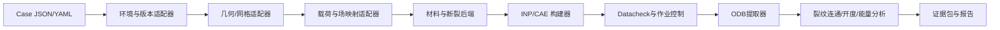

# 陶瓷型芯裂纹计算与二次开发扩展方案

## 1. 结论

陶瓷型芯可以复用载荷传递、候选区比较、裂纹模型选择、ODB 提取和结果分级。
材料、界面和载荷按型芯实际工艺设置。已有热应力保存场可以直接用于相对风险
比较。需要解析裂纹起点、路径或开口时，再建立相应的局部断裂模型。

按任务所需的证据选择计算深度。

1. 用完整型芯的温度、接触和应力场做全局筛查。
2. 对照同一物理时间和材料区域，识别危险位置及其变化。
3. 需要解析裂纹时，在局部区选择 XFEM、黏聚模型或其他适用方法。
4. 裂纹改变金属压力、接触支撑或传热时，按影响定义顺序耦合事件。
5. 用高温材料试验、CT/剖切、声发射或载荷—位移数据逐级校准。

做到第 1—2 步的可行性高；做到局部裂纹路径的可行性中高；做到可量化的工程
预测取决于高温断裂参数和实验验证；真正双向流固裂纹耦合可行但开发成本高，
不宜作为第一阶段目标。

## 2. 已有 skills 如何复用

| 现有能力 | 在陶瓷型芯中的复用方式 | 必须修改的部分 |
|---|---|---|
| ProCAST/Fluent/Abaqus 物理时间链 | 保留温度、压力、接触和结构响应的同一时间轴 | 型芯可能以充型、凝固和冷却时间为主，不再是排蜡时间窗 |
| 非匹配网格场映射 | 将温度、金属压力、接触状态映射到型芯网格 | 增加界面法向、遮挡面、湿润/未湿润区及映射守恒检查 |
| 全局风险筛查 | 用最大主应力、热梯度、应变能和 Weibull 指标找危险区 | 不能只使用蜡压代理量；需加入支撑、浮力、冲击和热失配 |
| 客观候选区竞争 | 多个候选区在相同参数下比较起裂 | 候选区应由全局场自动生成，实验裂纹只用于验证 |
| Abaqus XFEM | 未知主裂纹路径、少量主裂纹的起裂与扩展 | 判断 MAXPS 是否合适；可能需要混合模态或剪切/压力敏感准则 |
| STATUSXFEM/CSDMG/开度提取 | 连通裂纹、损伤、开度和时间线 | “连通”不等于“泄压”，需要新的物理事件定义 |
| 证据分级 | 区分筛查、机理、条件预测和预测部署 | 加入材料离散性、高温标定和多试样验证要求 |

## 3. 陶瓷型芯的典型受力场景

### 3.1 制造和装配阶段

- 干燥/烧结温差与收缩不均造成残余应力；
- 机加工、搬运和定位夹持造成局部弯曲或缺口应力；
- 型芯装配偏差和支撑过约束；
- 增材制造层间各向异性与孔隙缺陷。

这一类通常先做热—机械或静力全局筛查。若裂纹沿已知连接区或薄弱层扩展，
黏聚单元比 XFEM 更直接。

### 3.2 预热与充型阶段

- 型芯和型壳升温不同步形成热梯度；
- 金属液流动冲击、动压和局部停滞压力；
- 浮力、重力和支撑反力叠加；
- 金属—型芯接触建立与摩擦滑移。

若载荷变化快、接触切换剧烈或存在碎裂，应考虑 Abaqus/Explicit；若主要是
准静态热应力和金属静压，则 Abaqus/Standard 更经济。

### 3.3 凝固与冷却阶段

- 金属收缩和型芯热膨胀不匹配；
- 凝固壳层对型芯的包覆、夹持和拉脱；
- 接触区迁移、局部脱开和再接触；
- 高温蠕变或应力松弛。

这是最可能需要 ProCAST → Abaqus 顺序耦合的阶段。温度、接触压力以及金属位移
不能只取各自峰值拼接，应按同一物理时刻传递。

### 3.4 脱芯和后处理阶段

- 水激、热冲击、机械振动或冲击；
- 化学浸出导致截面逐步削弱；
- 已有微裂纹在二次载荷下扩展。

快速热冲击/机械冲击倾向 Explicit；化学削弱可采用分阶段材料/几何更新；若
目标是寿命或亚临界裂纹增长，需要新增循环或环境辅助断裂模型，不能只靠当前
单调 XFEM 流程。

## 4. 建议的仿真模型梯级

### 第一级：全局完整模型

利用可用的完整模型结果定位危险区、受拉时段和载荷机制。统一颈部或其他几何
区域后，结合参考体积加权的高分位拉应力、超阈应力的体积时间和热点位置评价。
涉及共用支承或型壳时，应同时检查相邻部件。评价区、阈值和比较窗口由任务定义。

模型内容：

- 型芯三维实体网格；
- 必要的型壳、金属或等效支撑/接触边界；
- 温度相关的弹性、热膨胀和传热参数；
- ProCAST/Fluent/试验输入的时变温度、压力和接触载荷；
- 最大主应力、热梯度、应变能、接触滑移及 Weibull 风险输出。

### 第二级：候选区局部断裂

目的：判断起裂位置、时间、路径和设计相对优劣。

推荐规则：

- 裂纹方向未知且以单个主裂纹为主：XFEM；
- 薄弱界面或已知裂纹走廊：黏聚面/黏聚单元；
- 已有界面预裂纹：VCCT；
- 分布式微裂纹只需等效刚度退化：弥散损伤；
- 冲击、碎裂和强接触：Explicit；
- 多裂纹竞争和分叉是论文核心：相场 UEL，但应单独立项验证。

### 第三级：事件驱动顺序耦合

当满足下列任一条件时，裂纹不能只作为后处理结果：

- 裂纹导致型芯失去支撑；
- 裂纹形成金属渗入或流体通道；
- 接触面积和压力分布显著改变；
- 裂纹改变传热边界或后续凝固过程。

此时在关键事件处停止结构计算，更新流动/热/接触边界，再继续下一段。该路线
仍属于顺序耦合，但比单向加载更可信，也比真正双向协同求解容易落地。

## 5. 材料与试验需求

### 相对筛查的输入

- `E(T)`、`ν(T)`、`α(T)`；
- 导热率、比热和密度；
- 随温度变化的工艺和支承条件。

若要把筛查指标换算成起裂条件或概率，需要相关温度下的强度数据和制造批次信息。

### 裂纹扩展集

- I 型断裂能 `Gf(T)` 或断裂韧度 `KIC(T)`；
- 若剪切重要，增加 II 型参数和混合模态关系；
- 压缩/剪切破坏指标；
- 高温蠕变/松弛参数；
- 速率效应（冲击/急冷）；
- Weibull 模量及尺度参数，或等效的强度离散模型。

室温手册值可以做敏感性分析，但不能支持高温绝对失效概率。建议以三点弯曲或
四点弯曲、缺口梁断裂、热冲击和小尺寸型芯构件试验组成分级标定集。

## 6. 软件模块建议

| 目标 | Abaqus 模块/能力 | 备注 |
|---|---|---|
| 稳态/瞬态温度 | Heat Transfer | 可先独立热分析再顺序映射 |
| 准静态热—机械 | Static, General 或 Coupled Temperature-Displacement | 接触和材料非线性决定是否直接耦合 |
| 未知路径裂纹 | XFEM crack + damage initiation/evolution | 先验证准则和富集区敏感性 |
| 已知界面开裂 | Surface-based cohesive behavior / cohesive elements | 需要法向、剪切强度和断裂能 |
| 预裂界面 | VCCT | 适合能量释放率判据 |
| 冲击/碎裂 | Dynamic, Explicit | 检查动能、质量缩放和时间尺度 |
| 多裂纹相场 | UEL/UMAT 二次开发 | 非 Abaqus 原生一键功能，需验证算例 |
| 统计脆断 | Python 后处理或用户子程序 | Weibull 风险可先作为全局筛查层 |

## 7. 二次开发架构

### 7.1 可直接通用化的接口

- `EnvironmentAdapter`：发现 Abaqus 版本、命令和本地配置；
- `LoadAdapter`：ProCAST、Fluent、CSV/HDF5、实验或解析载荷；
- `MaterialProvider`：温度相关、批次相关或统计材料集；
- `FractureBackend`：XFEM、黏聚、VCCT、Explicit、相场 UEL；
- `JobBackend`：datacheck、提交、监视、重启和结果收集；
- `ResultExtractor`：通过 `odbAccess` 输出统一表格；
- `EvidenceWriter`：生成 manifest、图表、哈希和结论等级。

### 7.2 推荐状态机

`PRECHECKED → BUILT → DATACHECKED → SOLVED → EXTRACTED → VALIDATED → PACKAGED`

每一步保存输入哈希、时间、软件版本、完成条件和失败原因。这样能复用已有批处理
和断点续算思路，并避免不同项目之间依赖个人记忆。

### 7.3 不应硬编码的内容

- Abaqus 安装路径、许可服务器和核数；
- 私有几何、网格、材料和实验照片；
- 固定的集合名、实例名和 ODB 路径；
- 只适用于蜡壳的压力公式、候选区和失效阈值；
- 未经校准的 `ft`、`Gf` 或稳定化参数。

## 8. 可行性与开发优先级

| 开发项 | 可行性 | 主要瓶颈 | 建议优先级 |
|---|---:|---|---:|
| 通用 case schema、环境发现、datacheck、ODB 统一提取 | 高 | Abaqus 版本差异 | P0 |
| 陶瓷型芯全局热—力筛查与候选区生成 | 高 | 接触和高温材料输入 | P0 |
| 温度/压力/接触场从 ProCAST 映射到 Abaqus | 中高 | 网格对应、法向和时间同步 | P0 |
| 局部 XFEM 起裂和单主裂纹扩展 | 中高 | 断裂参数、收敛和富集区 | P1 |
| 已知界面黏聚模型 | 高 | 界面参数标定 | P1 |
| Weibull 统计脆断与批次不确定性 | 中高 | 多试样统计数据 | P1 |
| 裂纹后接触/压力事件驱动更新 | 中 | 状态传递和重启一致性 | P2 |
| Explicit 碎裂/冲击 | 中 | 计算量、速率参数和质量缩放 | P2 |
| 相场多裂纹 UEL | 中 | 自研代码、验证和高计算成本 | P3 |
| 真正双向流固—裂纹耦合 | 中低 | 网格拓扑变化和跨求解器同步 | P3 |

总体建议：先把 P0 做成稳定平台，再选择 XFEM 或黏聚作为第一个裂纹后端。
不建议一开始就做相场或双向流固裂纹耦合，因为它们不会弥补材料参数和验证数据
不足，反而会显著增加不确定性。

## 9. 里程碑与验收

### M1：通用化基座

- 输入：一个公开的小型陶瓷梁/型芯演示模型；
- 输出：case 配置、datacheck、全局场和统一结果表；
- 验收：不同电脑只修改环境配置即可运行，路径中无私有硬编码。

### M2：型芯全局筛查

- 输入：温度、压力和接触时序；
- 输出：候选区和候选时间窗排名；
- 验收：网格/边界/材料区间变化后排名稳定或有可解释变化。

### M3：局部裂纹后端

- 输入：2—4 个客观候选区；
- 输出：起裂时间、连通路径、开度、能量和形貌；
- 验收：至少两个网格尺度、能量质量门槛和一项独立实验对照。

### M4：工程预测

- 输入：高温材料标定、多试样/多工况验证集；
- 输出：带置信区间的失效载荷/时间或设计排序；
- 验收：独立验证误差阈值、适用域和版本回归测试全部冻结。

## 10. 当前最合适的下一步

以一个典型陶瓷型芯为示范件，先完成“全局温度—接触—应力筛查 + 3 个客观候选
区 + XFEM/黏聚二选一的局部模型”。这一步既能最大程度复用现有 skills，也能尽快
暴露真正的瓶颈：究竟是载荷映射、材料标定、接触边界还是裂纹数值稳定性。
